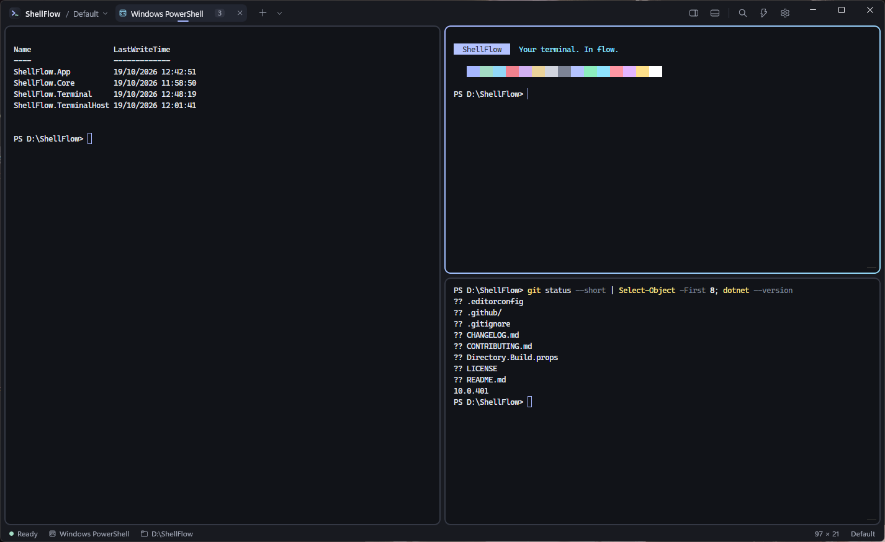
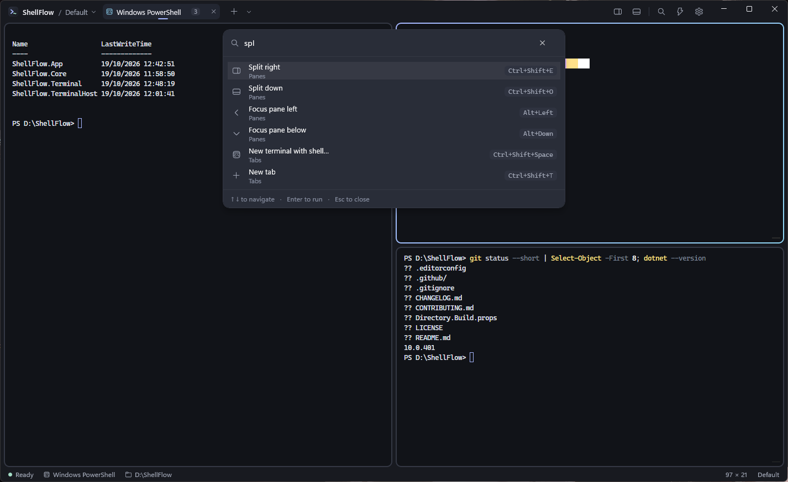
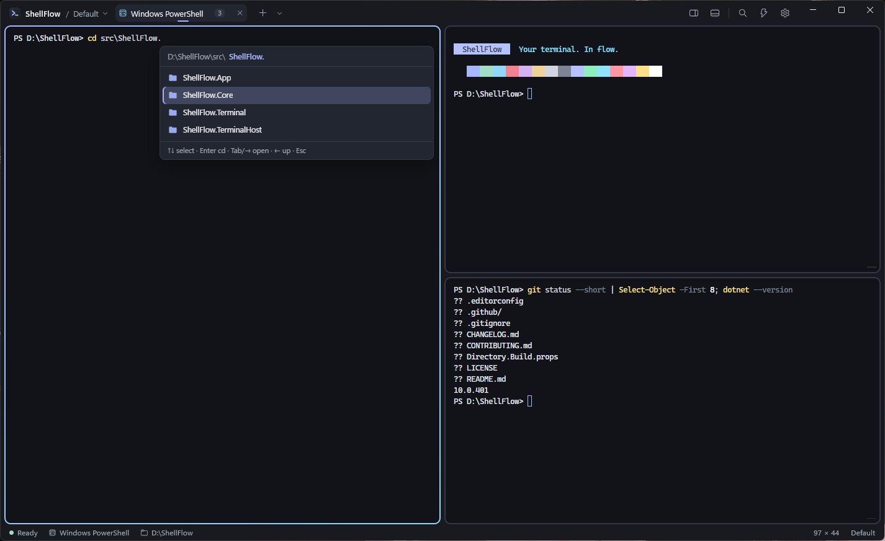
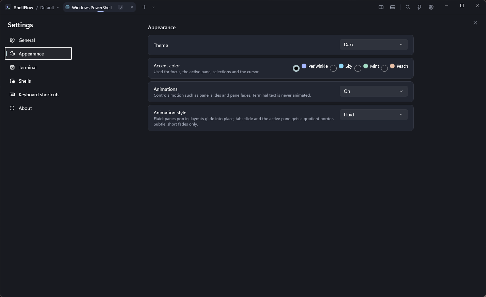

<p align="center">
  
</p>

<h1 align="center">ShellFlow</h1>
<p align="center"><b>Your terminal. In flow.</b></p>

<p align="center">
  <a href="https://github.com/RaulDevStack/shellflow/releases/latest"></a>
  <a href="https://github.com/RaulDevStack/shellflow/actions/workflows/ci.yml"></a>
  
  
  <a href="LICENSE"></a>
</p>

<p align="center">
  <a href="https://github.com/RaulDevStack/shellflow/releases/latest"><b>Download for Windows</b></a> ·
  <a href="#features">Features</a> ·
  <a href="#keyboard-shortcuts">Shortcuts</a> ·
  <a href="docs/ARCHITECTURE.md">Architecture</a>
</p>

ShellFlow is a modern, open-source terminal for Windows. It combines the multi-pane workflow of terminal
multiplexers like Terminator with the polish of a native desktop app: real shells through the Windows Pseudo Console,
xterm.js rendering, nested split panes, a command palette, a folder picker for `cd`, Explorer integration and
Hyprland-style motion — in a calm dark design.

<p align="center">
  
</p>

> **Status: early preview (0.1).** The core terminal, tabs, splits, palette, settings and installer work and are
> covered by tests. See [Known limitations](#known-limitations) before relying on it daily.

## Download

Get the latest version from the [**Releases page**](https://github.com/RaulDevStack/shellflow/releases/latest):

| File | What it is |
| --- | --- |
| `ShellFlow-<version>-x64.msi` | **Installer (recommended).** Per-user, no admin rights. Adds the Start menu entry, "Open ShellFlow here" in Explorer and `shellflow` in Win+R. |
| `ShellFlow-<version>-win-x64-portable.zip` | Portable single executable. Unzip anywhere and run `ShellFlow.exe` (keep that file name). |
| `SHA256SUMS.txt` | Checksums to verify the downloads. |

> The installer is not code-signed yet, so Windows SmartScreen may show *"Windows protected your PC"*. Choose
> **More info → Run anyway**, or verify the file against `SHA256SUMS.txt` first
> (`Get-FileHash .\ShellFlow-0.1.0-x64.msi`).

## Features

- **Real shells.** PowerShell 7 or Windows PowerShell (default), Command Prompt, and Git Bash / WSL distributions when
  installed — all detected automatically, plus your own custom shells.
- **Proper terminal emulation.** xterm.js with ANSI/256/true color, Unicode 11 widths, scrollback, selection, find,
  bracketed paste and optional GPU (WebGL) rendering.
- **Tabs and nested splits.** Split right or down as deep as you like, drag dividers, move focus and resize from the
  keyboard. Each pane is an independent shell; layout changes never restart them.
- **Folder-aware panes.** Shell integration lets PowerShell, Command Prompt and Git Bash report their current folder,
  so a new pane opens where the selected pane is, and the status bar shows the real folder.
- **cd folder picker.** Type `cd` (optionally part of a path) and press Tab to browse folders with the arrow keys:
  Enter changes directory, Tab/→ opens a folder, ← goes up (all the way to the drive list), typing filters.
- **One window.** Launching ShellFlow again (Start menu, Win+R, Explorer) reuses the open window.
- **Command palette** (`Ctrl+Shift+P`). Every action — toolbar, menus, shortcuts — goes through one command registry.
- **Clean start.** ShellFlow always opens with a single terminal; layouts from the previous session are not restored.
- **Workspaces.** Named sets of tabs and layouts you can save and switch between during a session.
- **Safe by default.** Confirmation before stopping running commands, multi-line paste warning, graceful process
  cleanup, recovery from corrupted settings, and a locked-down renderer ([security model](docs/SECURITY.md)).
- **Designed for flow.** Dark and light themes, four pastel accents, keyboard-first everything.
- **Hyprland-style motion.** Panes pop in, layouts glide into place with a soft overshoot, tabs slide like workspaces
  and the active pane gets a gradient border. Runs on the compositor so it never slows typing; switch to *Subtle* or turn
  animations off in Settings (Windows' animation setting is respected).

## Screenshots

| Command palette | cd folder picker |
| --- | --- |
|  |  |

| Settings | |
| --- | --- |
|  | |

## Keyboard shortcuts

| Action | Shortcut |
| --- | --- |
| Command palette | `Ctrl+Shift+P` |
| New tab / choose shell | `Ctrl+Shift+T` / `Ctrl+Shift+Space` |
| Next / previous tab | `Ctrl+Tab` / `Ctrl+Shift+Tab` (or `Ctrl+PgDn` / `Ctrl+PgUp`) |
| Close tab | `Ctrl+F4` |
| Split right / down | `Ctrl+Shift+E` / `Ctrl+Shift+O` (or `Alt+Shift+=` / `Alt+Shift+-`) |
| Close pane | `Ctrl+Shift+W` |
| Move focus between panes | `Alt+Arrow`, `Ctrl+Shift+]` / `Ctrl+Shift+[` |
| Move divider | `Alt+Shift+Arrow` |
| Copy / paste | `Ctrl+Shift+C` (or `Ctrl+C` with a selection) / `Ctrl+Shift+V`, `Ctrl+V`, `Shift+Insert`, right-click |
| Find | `Ctrl+Shift+F` |
| Font size | `Ctrl+=` / `Ctrl+-` / `Ctrl+0` |
| Settings / shortcut list | `Ctrl+,` / `Ctrl+Shift+/` |
| Switch workspace | `Ctrl+Shift+K` |

Shortcuts can be changed in `settings.json` (`keyBindings`, see [settings.example.json](docs/settings.example.json)).

## Requirements

- **Windows 11** (primary target). Windows 10 version 2004 (build 19041) or later is expected to work but is not yet
  verified — see [Windows 10](#windows-10).
- **Microsoft Edge WebView2 Runtime** (preinstalled on Windows 11; ShellFlow shows a notice if it is missing).
- x64 or ARM64.

## Installing

Run `ShellFlow-<version>-x64.msi`. It installs for the current user only (no administrator prompt) into
`%LOCALAPPDATA%\Programs\ShellFlow` and adds:

- **ShellFlow** to the Start menu,
- **Open ShellFlow here (new tab)** and **Open ShellFlow here (new pane)** when right-clicking a folder, the empty
  space inside a folder, or a drive in Explorer. If ShellFlow is already open, the folder opens as a new tab or as a
  new pane in the current tab of that window — ShellFlow never opens twice. (On Windows 11 these entries are under
  *Show more options*, or Shift+right-click — the compact Windows 11 menu only accepts packaged MSIX extensions.)
- `shellflow` as a command for Win+R,
- an entry in Settings → Apps → Installed apps, where it can be uninstalled.

New versions upgrade in place. Uninstalling keeps your settings in `%LOCALAPPDATA%\ShellFlow`.

### Command line

```text
ShellFlow.exe [--new-tab | --new-pane] [-d|--directory <folder>] [-p|--profile <id>] [<folder>]
```

For example `shellflow -d C:\src -p cmd` opens Command Prompt in `C:\src`. When ShellFlow is already running the
request goes to the open window: `--new-pane` splits the current tab, `--new-tab` (or just a folder) opens a tab, and
a plain `shellflow` brings the window to the front. Profile ids are listed in Settings → Shells
(`windows-powershell`, `pwsh`, `cmd`, `git-bash`, `wsl-<distro>`, or your own).

## Building from source

Prerequisites:

- [.NET SDK 10.0](https://dotnet.microsoft.com/download) (the repo pins `10.0.100` with roll-forward in `global.json`)
- Windows 10 2004+ / Windows 11. Visual Studio 2022/2026 with the *WinUI application development* workload is
  optional — everything builds with the .NET CLI.
- Node.js is **not** required (xterm.js is vendored); it is only needed to update xterm.js (`web/`).

```powershell
git clone https://github.com/RaulDevStack/shellflow.git ShellFlow
cd ShellFlow
dotnet build ShellFlow.slnx -p:Platform=x64
.\src\ShellFlow.App\bin\x64\Debug\net10.0-windows10.0.19041.0\win-x64\ShellFlow.exe
```

Use `-p:Platform=ARM64` on ARM64 devices. The app is unpackaged and self-contained with respect to the Windows App SDK,
so the build output runs directly.

### Running tests

```powershell
dotnet test tests/ShellFlow.Tests
```

See [docs/TESTING.md](docs/TESTING.md) for what the tests cover, how to drive the real UI, and the manual verification
checklist.

### Portable release build

```powershell
.\build\publish.ps1                     # → artifacts\ShellFlow-<version>-win-x64\ShellFlow.exe (single file)
.\build\publish.ps1 -Runtime win-arm64
.\build\publish.ps1 -Folder             # → folder build + artifacts\ShellFlow-<version>-win-x64.zip
.\build\publish.ps1 -Installer          # → artifacts\installer\ShellFlow-<version>-x64.msi
```

The installer is built with [WiX Toolset 5](https://wixtoolset.org/) from NuGet (`installer/`), so no extra tools need
to be installed. `build/make-installer-art.ps1` regenerates its license page and artwork.

The default output is one self-contained `.exe` (about 86 MB): copy it anywhere and run it, no .NET or Windows App
SDK installation needed. It unpacks its native libraries to a cache folder the first time it runs. **Keep the file
name `ShellFlow.exe`** — the Windows App SDK locates the embedded UI resources by the executable's name, and a renamed
copy fails to start. The `-Folder`
variant starts slightly faster because nothing is unpacked. For a normal installation use the MSI below.

## Configuration

Everything lives in `%LOCALAPPDATA%\ShellFlow` (override with the `SHELLFLOW_DATA_DIR` environment variable):

| File | Contents |
| --- | --- |
| `settings.json` | Preferences, custom shells, key-binding overrides ([example](docs/settings.example.json)) |
| `workspaces\*.json` | Saved workspaces (tabs, split layouts, starting directories) |
| `state.json` | Last workspace, window placement |
| `logs\` | Lifecycle and error logs (never terminal input/output) |

Settings are validated on load; invalid values are corrected and reported, and an unreadable file is kept aside as
`settings.corrupt-<timestamp>.json`.

### Showing the current directory

With **Shell integration** on (Settings → General, default), ShellFlow makes PowerShell, Command Prompt and Git Bash
report their folder automatically: PowerShell's existing prompt function is wrapped after your profile loads, CMD's
`PROMPT` and Git Bash's `PROMPT_COMMAND` get an invisible OSC 9;9 prefix. Profiles that set their own `PROMPT` /
`PROMPT_COMMAND` or run their own `-Command`/`-File` are left untouched. WSL is not integrated yet.

Any other shell can report its folder with OSC 7 or OSC 9;9. To do it by hand in PowerShell (for example with
integration off), add this to your profile:

```powershell
function prompt {
  $loc = $executionContext.SessionState.Path.CurrentLocation
  $osc = if ($loc.Provider.Name -eq 'FileSystem') { "$([char]27)]9;9;`"$($loc.ProviderPath)`"$([char]27)\" } else { '' }
  "$osc" + "PS $loc$('>' * ($nestedPromptLevel + 1)) "
}
```

New panes created by splitting inherit a reported directory.

## Architecture

```
ShellFlow.App (WinUI 3) ──▶ ShellFlow.TerminalHost (WebView2 + xterm.js) ──▶ ShellFlow.Terminal (ConPTY)
        └───────────────────────────── ShellFlow.Core (models, layout, persistence, commands) ◀┘
```

Read [docs/ARCHITECTURE.md](docs/ARCHITECTURE.md) for the data flow (output streaming with backpressure, resizing,
command routing) and [docs/SECURITY.md](docs/SECURITY.md) for the renderer trust boundary. Design tokens and motion
guidelines are in [docs/DESIGN.md](docs/DESIGN.md); measured startup and throughput numbers, with test conditions, are in
[docs/PERFORMANCE.md](docs/PERFORMANCE.md).

## Known limitations

- Switching to a saved workspace restores its layout with fresh shells in the saved directories; running programs are
  not restored.
- "Command running" detection uses the shell's process tree; work done inside the shell process itself (for example a
  long PowerShell pipeline without child processes) is not detected for close confirmations.
- The working directory is only known when the shell reports it (see above); WSL panes and unknown shells fall back to
  the folder they started in, and the cd picker then only completes absolute paths.
- Key bindings are customizable through `settings.json` only (the Settings UI lists them).
- Links in terminal output are not clickable yet.
- Windows 10 and ARM64 builds compile but have not been verified on real hardware.
- Each pane hosts its own WebView2 renderer (sharing one browser process); very large numbers of panes use more memory
  than a native renderer would.
- Some systems draw a small dash near the bottom-right corner of each pane. It is drawn above all app content (including
  dialogs), which points to an OS-level text-cursor overlay rather than ShellFlow's UI; under investigation.

## Windows 10

ShellFlow targets Windows 10 version 2004 (build 19041) as its minimum because it uses ConPTY, Windows App SDK 1.8 and
`UISettings.AnimationsEnabledChanged`. Expect differences: no Segoe Fluent Icons (falls back to Segoe MDL2 Assets),
square window corners, and older ConPTY behavior on early builds. Reports from Windows 10 users are welcome.

## Roadmap

- Code signing, winget manifest, and a signed MSIX for the compact Windows 11 context menu
- Clickable links (opened through the default browser with confirmation)
- Key-binding editor in Settings
- Drag-and-drop of files to paste paths
- Pane zoom (temporarily maximize a pane), broadcast input to all panes
- Per-profile colors and themes, theme import
- Shell integration helpers (prompt marks, command status)

## Contributing

Contributions are welcome — please read [CONTRIBUTING.md](CONTRIBUTING.md). Bug reports and feature requests use the
issue templates.

## License

ShellFlow is released under the [MIT License](LICENSE). Third-party components are listed in
[docs/SECURITY.md](docs/SECURITY.md#dependencies) with their licenses; their notices ship in `THIRD-PARTY-NOTICES.txt`.
